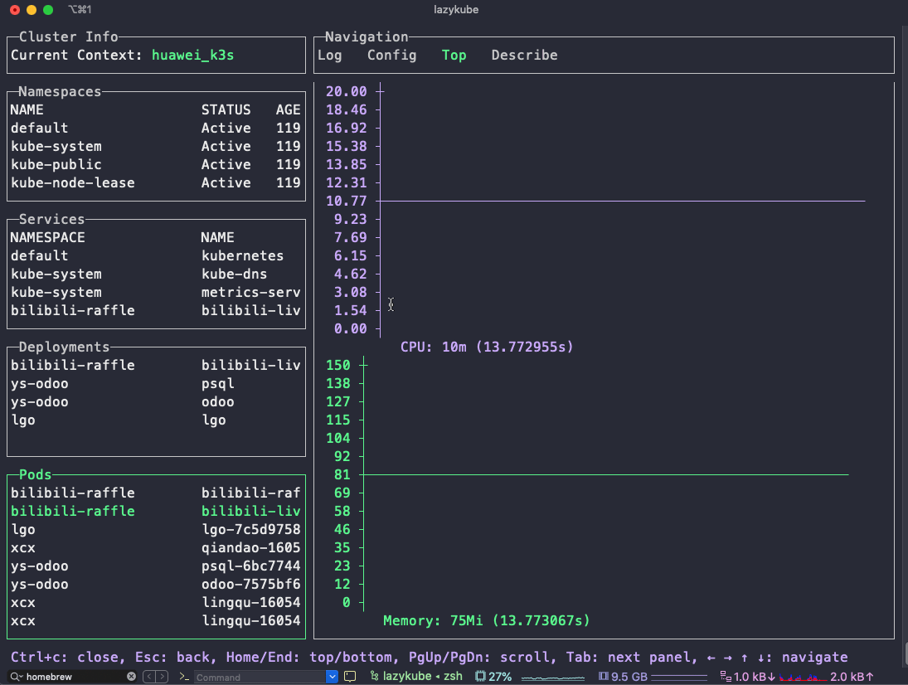
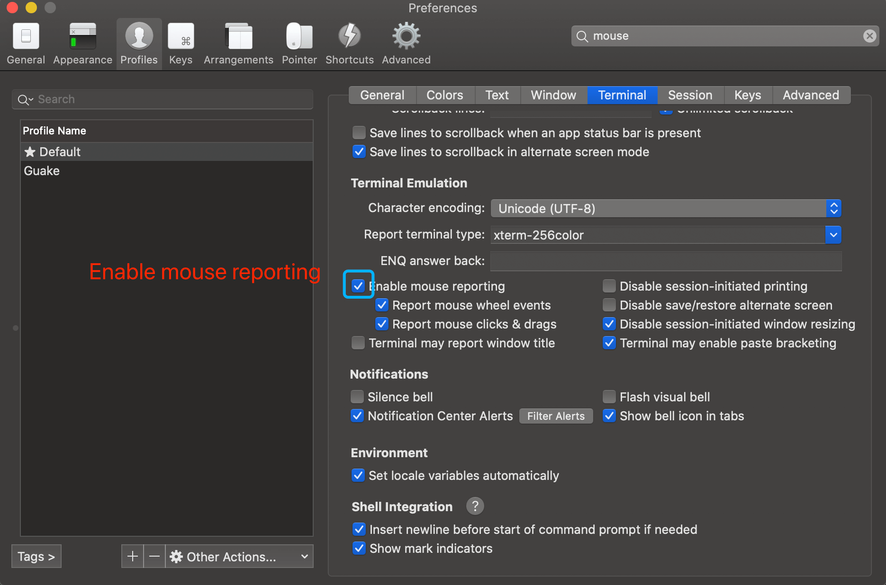

# lazykube

Manage Kubernetes clusters from the terminal with keyboard and mouse.

([English Document](README.md) | [中文文档](./docs/README_CN.md))



## Installation

Requires Go 1.26 or newer. With an older Go installed, the required toolchain is downloaded automatically when `GOTOOLCHAIN=auto` (the default).

```bash
$ git clone https://github.com/vynazevedo/lazykube.git
$ cd lazykube
$ go build -o lazykube ./cmd/lazykube
$ sudo mv lazykube /usr/local/bin/
```

## How to use

```bash
$ lazykube
```

lazykube uses the current context of your kubeconfig (`KUBECONFIG` or `~/.kube/config`).

## FAQ

* When using iterm2 as a terminal, mouse clicks cannot be used ?



## Change log

[CHANGELOG](CHANGELOG.md)

Breaking changes of the modernization (Go 1.26, Kubernetes v0.36, new TUI backend) are documented in [docs/MODERNIZACAO.md](docs/MODERNIZACAO.md).
