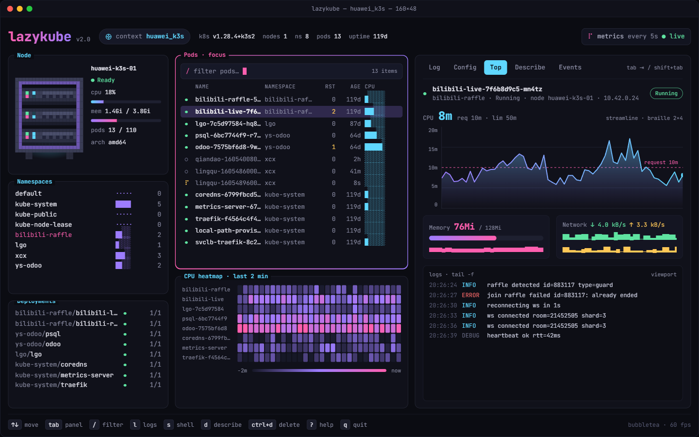

```
 ██╗      █████╗ ███████╗██╗   ██╗██╗  ██╗██╗   ██╗██████╗ ███████╗
 ██║     ██╔══██╗╚══███╔╝╚██╗ ██╔╝██║ ██╔╝██║   ██║██╔══██╗██╔════╝
 ██║     ███████║  ███╔╝  ╚████╔╝ █████╔╝ ██║   ██║██████╔╝█████╗
 ██║     ██╔══██║ ███╔╝    ╚██╔╝  ██╔═██╗ ██║   ██║██╔══██╗██╔══╝
 ███████╗██║  ██║███████╗   ██║   ██║  ██╗╚██████╔╝██████╔╝███████╗
 ╚══════╝╚═╝  ╚═╝╚══════╝   ╚═╝   ╚═╝  ╚═╝ ╚═════╝ ╚═════╝ ╚══════╝
```

<div align="center">

```
 ┌──────────────────────────────────────────────────────────────┐
 │   kubectl get pods, mas com contexto, métricas e logs        │
 │   na mesma tela.                                             │
 └──────────────────────────────────────────────────────────────┘
```

[](LICENSE)
[](https://github.com/vynazevedo/lazykube/actions/workflows/ci.yaml)
[](https://github.com/vynazevedo/lazykube/stargazers)

[](https://go.dev/)
[](https://kubernetes.io/)
[](https://github.com/charmbracelet/bubbletea)
[](https://www.linux.org/)

**A fast terminal UI to watch your Kubernetes cluster.** (EN)

**Uma TUI rápida para acompanhar seu cluster Kubernetes pelo terminal.** (PT-BR)

Pods, deployments, namespaces, node, CPU, memória, rede, logs, eventos e YAML
em um único layout, atualizado em tempo real por informers e com animações
suaves. Funciona com qualquer contexto do seu kubeconfig e degrada com
elegância quando falta permissão ou metrics-server.

*Somente leitura: o lazykube observa o cluster e nunca altera nada.*

---



</div>

```
 ╔═══════════════════════════════════════════════════════╗
 ║                    T A B L E                          ║
 ║                 O F  C O N T E N T S                  ║
 ╠═══════════════════════════════════════════════════════╣
 ║                                                       ║
 ║  [0x01] .... Instalação                            ║
 ║  [0x02] .... Uso                                      ║
 ║  [0x03] .... Layout                                   ║
 ║  [0x04] .... Atalhos                                  ║
 ║  [0x05] .... Métricas e permissões                    ║
 ║  [0x06] .... Estrutura do projeto                     ║
 ║  [0x07] .... Compatibilidade                          ║
 ║  [0x08] .... Contribuindo                             ║
 ║                                                       ║
 ╚═══════════════════════════════════════════════════════╝
```

---

## `[0x01]` Instalação

Baixe o instalador completo para um arquivo temporário e execute somente
se o download terminar com sucesso. Ele instala a última release após
verificar o SHA-256:

```bash
(
  set -euo pipefail
  instalador=$(mktemp)
  trap 'rm -f "$instalador"' EXIT
  curl -fsSL https://raw.githubusercontent.com/vynazevedo/lazykube/main/install.sh -o "$instalador"
  bash "$instalador"
)
```

Alternativa com execução pelo pipe, em Bash. `pipefail` propaga falhas do
download; prefira o arquivo temporário para aguardar o download completo:

```bash
(
  set -o pipefail
  curl -fsSL https://raw.githubusercontent.com/vynazevedo/lazykube/main/install.sh | bash
)
```

Compatível com Linux, macOS e Windows via Git Bash, MSYS ou Cygwin, nas
arquiteturas amd64 e arm64. Não requer Go. O instalador usa `curl` ou `wget`,
`sha256sum` ou `shasum`, `tar` no Linux/macOS e `unzip` no Windows.

Por padrão, instala em `/usr/local/bin` quando há permissão de escrita ou
em `~/.local/bin` caso contrário. Não executa `sudo`. Para escolher a versão
e o destino (substitua `vX.Y.Z` por uma tag publicada):

```bash
(
  set -euo pipefail
  instalador=$(mktemp)
  trap 'rm -f "$instalador"' EXIT
  curl -fsSL https://raw.githubusercontent.com/vynazevedo/lazykube/main/install.sh -o "$instalador"
  VERSION=vX.Y.Z INSTALL_DIR="$HOME/.local/bin" bash "$instalador"
)
export PATH="$HOME/.local/bin:$PATH"
```

Alternativa com wget:

```bash
(
  set -euo pipefail
  instalador=$(mktemp)
  trap 'rm -f "$instalador"' EXIT
  wget -qO "$instalador" https://raw.githubusercontent.com/vynazevedo/lazykube/main/install.sh
  bash "$instalador"
)
```

### Download manual

Na [página de releases](https://github.com/vynazevedo/lazykube/releases/latest),
baixe `checksums.txt` e o arquivo correspondente. `X.Y.Z` representa a versão
sem o prefixo `v`.

| Plataforma | amd64 (Intel/AMD) | arm64 (Apple Silicon/ARM) |
| --- | --- | --- |
| Linux | `lazykube_X.Y.Z_linux_amd64.tar.gz` | `lazykube_X.Y.Z_linux_arm64.tar.gz` |
| macOS | `lazykube_X.Y.Z_darwin_amd64.tar.gz` | `lazykube_X.Y.Z_darwin_arm64.tar.gz` |
| Windows | `lazykube_X.Y.Z_windows_amd64.zip` | `lazykube_X.Y.Z_windows_arm64.zip` |

Antes de extrair, confira somente a linha do arquivo baixado:

```bash
arquivo=lazykube_X.Y.Z_linux_amd64.tar.gz
awk -v nome="$arquivo" '$2 == nome {print}' checksums.txt > checksum-selecionado.txt
test "$(wc -l < checksum-selecionado.txt)" -eq 1
sha256sum -c checksum-selecionado.txt
```

No macOS, use `shasum -a 256 -c checksum-selecionado.txt` no lugar de
`sha256sum -c checksum-selecionado.txt`.

Prossiga apenas se a verificação terminar com sucesso (`OK`). Extraia com
`tar -xzf "$arquivo"` (Linux/macOS) ou `unzip "$arquivo"` (Git Bash) e copie
`lazykube` ou `lazykube.exe` para um diretório no `PATH`. No PowerShell,
compare `(Get-FileHash .\lazykube_X.Y.Z_windows_amd64.zip -Algorithm SHA256).Hash`
com a entrada correspondente em `checksums.txt` antes de usar `Expand-Archive`.

### Instalar com Go

Com Go 1.26 ou superior:

```bash
go install github.com/vynazevedo/lazykube/cmd/lazykube@latest
```

O binário fica em `GOBIN` ou em `$(go env GOPATH)/bin`. Adicione esse diretório
ao `PATH`. Para fixar uma versão, substitua `@latest` por uma tag publicada.
Essa instalação compila o código e não usa os arquivos de checksum das releases.
A versão no cabeçalho pode diferir da tag, pois `go install` não usa os ldflags
do GoReleaser. Para identificação da versão e verificação dos pacotes publicados,
prefira os binários da release.

### SBOM e assinatura da release

Releases geradas pelo workflow incluem um SBOM por pacote e
`checksums.txt.sigstore.json`, um bundle de assinatura keyless do manifesto.
Após baixar esses arquivos da mesma tag, verifique com Cosign 3.1.4:

```bash
VERSION=vX.Y.Z
cosign verify-blob checksums.txt \
  --bundle checksums.txt.sigstore.json \
  --certificate-identity "https://github.com/vynazevedo/lazykube/.github/workflows/release.yml@refs/tags/$VERSION" \
  --certificate-oidc-issuer https://token.actions.githubusercontent.com
```

Só depois confira o checksum do pacote conforme o download manual. O instalador
Bash verifica SHA-256, mas não verifica a assinatura Sigstore automaticamente.
Releases anteriores podem não ter SBOM ou assinatura. Snapshots locais não são
assinados. [Referência do fluxo de assinatura](https://goreleaser.com/customization/sign/sign/).

### Compilar a partir do código

Requer Go 1.26 ou superior:

```bash
git clone https://github.com/vynazevedo/lazykube.git
cd lazykube
go build -o lazykube ./cmd/lazykube
mkdir -p "$HOME/.local/bin"
cp lazykube "$HOME/.local/bin/"
```

Para ver a interface sem acessar nenhum cluster:

```bash
lazykube --demo --no-anim
```

O uso com um cluster requer um kubeconfig válido.

O processo inicia somente leitura (`[RO]`). A flag `--read-write` libera
a tentativa de acoes apenas neste processo, sujeita a RBAC e a politica do
contexto. Contextos protegidos continuam bloqueados. O executor e os contratos
para futuros handlers de acoes estao descritos em
[Guardrails](internal/guard/README.md); esta entrega nao adiciona teclas de mutacao.
`--protected-contexts` e `--read-only-contexts` recebem nomes exatos separados
por virgula. `--audit-file` permite escolher um caminho absoluto para o audit
privado. Nenhuma tecla desativa a politica.

---

## Comparação de escopo

O quadro descreve o código disponível nesta revisão, sem atribuir ao lazykube
as ações planejadas para a 1.0 ou prometer vantagem de desempenho.

| Aspecto | lazykube | k9s | Lens |
| --- | --- | --- | --- |
| Interface | TUI no terminal | TUI no terminal | Aplicativo gráfico |
| Pods, deployments e logs | Visualização no terminal | Navegação de recursos e logs | Visualização de workloads e logs |
| Alterar recursos | Não exposto na TUI desta revisão | Operações de gestão; modo `--readonly` disponível | Edição disponível conforme RBAC |
| Foco | Inspeção, diagnóstico e contexto em uma tela | Gestão de recursos pelo terminal | Gestão por interface gráfica |

Fontes: [k9s](https://k9scli.io/),
[modo somente leitura do k9s](https://k9scli.io/topics/commands/),
[pods no Lens](https://docs.lenshq.io/k8slens/using-lens/workloads/pods/).
Não há benchmark comparativo neste repositório. Exec, port-forward e edição
planejados para a 1.0 dependem de implementação e validação próprias.

## Matriz de suporte da 1.0

A matriz alvo é Kubernetes 1.34 a 1.36. O CI usa envtest para validar conexão,
leitura de pods/deployments/events e alternância entre dois servidores isolados.

| Linha | API local testada | Estado além desse teste |
| --- | --- | --- |
| Kubernetes 1.34 | envtest 1.34.1 | Preview até validar os demais fluxos |
| Kubernetes 1.35 | envtest 1.35.0 | Preview até validar os demais fluxos |
| Kubernetes 1.36 | envtest 1.36.2 | Preview até validar os demais fluxos |

São gerados seis artefatos: Linux, macOS e Windows em amd64 e arm64.
Cross-build não equivale a teste nativo: Linux amd64 tem validação local;
Linux arm64, macOS e Windows permanecem preview quanto à execução nativa.
Envtest não inclui kubelet, scheduler ou execução de containers e não valida
exec, port-forward ou metrics-server. Não se concede `nodes/proxy` para ampliar
a cobertura; sua ausência deve resultar em degradação explícita da funcionalidade.

---

## `[0x02]` Uso

```
 ┌─ FLAGS ──────────────────────────────────────────────────────────────┐
 │                                                                      │
 │  lazykube                        # contexto atual do kubeconfig      │
 │  lazykube --context staging      # escolhe o contexto                │
 │  lazykube -n apps                # limita a um namespace             │
 │  lazykube --kubeconfig ~/k.yaml  # kubeconfig alternativo            │
 │  lazykube --palette ocean        # paleta: charm, ocean ou matrix    │
 │  lazykube --fps 30               # quadros por segundo (1 a 60)      │
 │  lazykube --no-anim              # desliga animações                 │
 │  lazykube --demo                 # dados sintéticos determinísticos  │
 │                                                                      │
 └──────────────────────────────────────────────────────────────────────┘
```

Ao iniciar, uma tela de loading animada mostra cada etapa da conexão:
kubeconfig, contexto e versão do servidor, permissões e sincronização do
cache. Se uma etapa falhar, a tela aponta qual foi e por quê; `q` sai e
`ctrl+c` cancela a conexão a qualquer momento.

O lazykube só lê o cluster: lista e observa recursos, segue logs e consulta
métricas. Nenhuma ação de escrita é executada.

---

## `[0x03]` Layout

```
 ┌─ ESQUERDA ──────────┬─ CENTRO ─────────────────┬─ DIREITA ──────────────┐
 │                     │                          │                        │
 │  Node               │  Pods (foco, filtro /)   │  Log      tail -f      │
 │   cpu, mem, pods    │   status, restarts,      │  Config   YAML         │
 │  Namespaces         │   idade, cpu ao vivo     │  Top      cpu, mem,    │
 │   pods por ns       │                          │           rede, logs   │
 │  Deployments        │  CPU heatmap             │  Describe              │
 │   ready / desired   │   pods mais ativos       │  Events                │
 │                     │                          │                        │
 └─────────────────────┴──────────────────────────┴────────────────────────┘
```

Abaixo de 140 colunas a coluna esquerda é recolhida automaticamente; a
tecla `1` alterna manualmente em qualquer largura. O mouse funciona em todos
os painéis: clique seleciona, a roda rola e o clique na aba troca de aba.

---

## `[0x04]` Atalhos

```
 ┌─ NAVEGAÇÃO ───────────────────────────────────────────┐
 │                                                       │
 │  ↑ ↓  /  k j       move a seleção                     │
 │  tab / shift+tab   próximo / anterior painel          │
 │  /                 filtra pods (nome e namespace)     │
 │  enter             filtra pods pelo namespace         │
 │  esc               limpa filtros                      │
 │  1                 mostra / esconde coluna esquerda   │
 │                                                       │
 ├─ DETALHES ────────────────────────────────────────────┤
 │                                                       │
 │  l  c  t  d  e     Log, Config, Top, Describe, Events │
 │  [  ]              aba anterior / próxima             │
 │  f                 liga / desliga follow dos logs     │
 │  w                 quebra de linha                    │
 │  g  G              topo / fim                         │
 │  pgup  pgdn        página                             │
 │                                                       │
 ├─ GERAL ───────────────────────────────────────────────┤
 │                                                       │
 │  p                 troca a paleta de cores            │
 │  ctrl+p            pausa / retoma animações           │
 │  ?                 ajuda                              │
 │  q  ctrl+c         sair                               │
 │                                                       │
 └───────────────────────────────────────────────────────┘
```

---

## `[0x05]` Métricas e permissões

Os gráficos são montados a partir do metrics-server e do kubelet. Nada é
inventado: o histórico cresce a cada nova amostra (resolução padrão de 15s)
e, enquanto a janela enche, o painel mostra `coletando 12/60`.

```
 RECURSO                         USO                        SEM PERMISSÃO
 ───────                         ───                        ─────────────
 pods, deployments (list/watch)  base da interface          não inicia
 events (list/watch)             aba Events                 aviso na aba
 namespaces (list/watch)         painel Namespaces          deriva dos pods
 nodes (list/watch)              painel Node                contagem pelos pods
 metrics.k8s.io pods, nodes      CPU, memória, heatmap      motivo no painel
 nodes/proxy (get)               rede RX/TX                 motivo no card
```

Quando algo falta, o painel diz o motivo em vez de ficar vazio, por exemplo
`metrics-server não instalado`, `sem permissão: nodes/proxy` ou
`obsoleto: kubelet indisponível`.

---

## `[0x06]` Estrutura do projeto

```
lazykube/
├── cmd/lazykube/        # entrada, flags e conexao
├── internal/
│   ├── app/             # modelo Bubble Tea, layout, teclas, mouse, loading
│   ├── ui/              # painéis: node, pods, heatmap, detalhes, loading
│   ├── kube/            # informers, logs, metrics-server e kubelet stats
│   ├── data/            # contrato de dados e fonte demo
│   ├── draw/            # canvas, braille, larguras de grafema
│   ├── anim/            # relógio, springs e fades
│   └── theme/           # paletas e gradientes
├── pkg/                 # utilitários herdados
└── assets/              # imagens do README
```

---

## `[0x07]` Compatibilidade

```
 PLATAFORMA          STATUS
 ──────────          ──────
 Linux (amd64)       testado
 WSL2 (Ubuntu)       testado
 Linux (arm64)       não testado
 macOS               não testado
```

O acesso ao cluster usa `client-go` v0.36 e funciona com qualquer
distribuição que exponha a API padrão do Kubernetes (k3s, kind, GKE, EKS,
AKS). Os gráficos de CPU e memória dependem do metrics-server instalado.

Use um terminal com true color e uma fonte com caracteres braille e de bloco
(JetBrainsMono, Fira Code, Cascadia). No iTerm2, habilite *mouse reporting*
para usar o mouse.

---

## `[0x08]` Contribuindo

Veja [CONTRIBUTING.md](CONTRIBUTING.md), [CODE_OF_CONDUCT.md](CODE_OF_CONDUCT.md)
e [SECURITY.md](SECURITY.md). O projeto é distribuído sob
[Apache-2.0](LICENSE), com os créditos de origem em [NOTICE](NOTICE).

```
 1. Fork o repo
 2. Crie uma branch (git switch -c minha-feature)
 3. Commit (git commit -m "feat: minha feature")
 4. Push (git push origin minha-feature)
 5. Abre um PR
```

Validação local, a mesma do CI:

```bash
go vet ./...
go test -race -count=1 ./...
golangci-lint run ./...
```

Os testes usam `client-go` fake e goldens de tela; nenhum cluster real é
necessário. Para atualizar os goldens após uma mudança visual intencional:
`go test ./internal/app ./internal/ui -update`.

---

<div align="center">

```
 ┌──────────────────────────────────────────────────────────────┐
 │           Interface construída com Bubble Tea v2.           │
 └──────────────────────────────────────────────────────────────┘
```

**[@vynazevedo](https://github.com/vynazevedo)**

</div>
